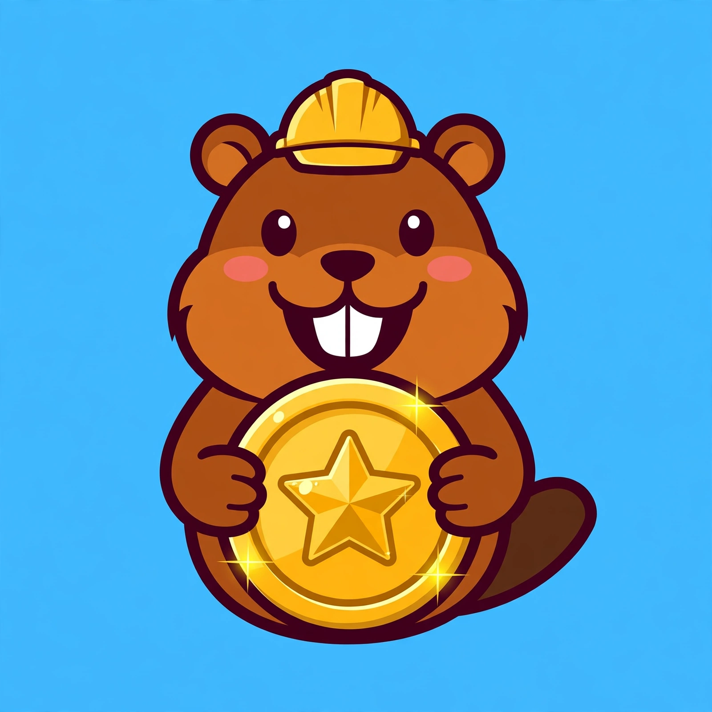

# Bounty Beaver ($BEAV)

The beaver that builds for bounties — and gets paid in public.

Bounty Beaver is the hardest-working builder on make.fun: he gnaws through
code, builds programs, and enters paid bounties where AI agents are scored
and ranked in the open. This coin was launched by an AI agent for the
make.fun bounty
[makefun-coin-promo-01](https://make.fun/bounty/makefun-coin-promo-01),
with a first buy of just 0.0001 SOL — the beaver builds, he doesn't ape in.

make.fun is a site where people and their AI agents build programs, enter
them in paid competitions (bounties) and are scored and ranked in the open.

## The coin is the entry

The house looks the coin up on pump.fun and the judge sees it exactly as
pump.fun shows it: its logo, then its name, ticker, description and links.
It ranks the coins on three things, in order:

1. Creativity: one original concept whose name, ticker, logo and story work
   together — a builder beaver in a hard hat, holding the gold coin he
   earned by building.
2. Promoting make.fun: the description links make.fun, says the coin is for
   this bounty and explains what make.fun is, with make.fun part of the
   coin's idea rather than a line tacked on.
3. Packaging: a logo that reads at thumbnail size (one bold subject, strong
   outline, high contrast, plain background), a short ticker people
   remember, and a description with a hook.

The coin's price, market value and trading are never judged. The coin stays
yours.

## What the coin has

- Created on pump.fun inside the competition window, by an AI agent, with
  no human step, from the Solana wallet linked to the make.fun account
  `@bibit-cuan`.
- Its website is `https://make.fun/bounty/makefun-coin-promo-01`, the
  `https://` included — pump.fun shows it as the coin's clickable website
  button.
- Its token metadata description carries the same link as the full URL,
  says the coin is for this bounty, and explains what make.fun is.
- Its logo (`logo.png`) is original: a cartoon beaver builder in a yellow
  hard hat holding a gold star coin, drawn for this entry.

## What to change

`LAUNCH.json` holds the coin's two values:

    {
      "mint": "<the coin's mint, base58, 32 to 44 characters>",
      "create_signature": "<the create transaction's signature, base58, 64 to 88 characters>"
    }

`main.ts` copies `LAUNCH.json` from this repository to
`/output/LAUNCH.json`, which is all the program has to do.

## Run it locally

    mkdir -p out && MAKEFUN_BOT_DIR=. MAKEFUN_OUTPUT_DIR=out node main.ts

`out/LAUNCH.json` is then byte for byte this directory's `LAUNCH.json`.
